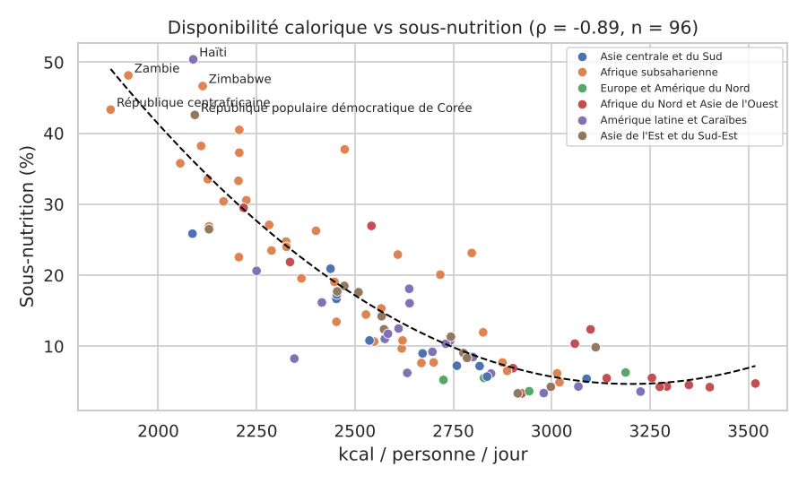

# FAO DataLab : analyse mondiale de la sécurité alimentaire

Projet réalisé par **Patrick MWANIA MAZEMBE** dans le cadre de la formation *Concepteur Développeur en IA et
Analyse Big Data* (Wild Code School, groupe Simplon, 2026).

À partir des données FAO 2013 (bilans alimentaires, population, sous-alimentation) de **174 pays et
territoires**, le projet répond à trois questions :

1. Quelles régions sont les plus touchées par la sous-nutrition ?
2. Qu'est-ce qui, dans l'alimentation d'un pays, est associé à la sous-nutrition ?
3. Peut-on regrouper les pays par profil alimentaire pour mieux cibler l'aide ?

## Résultats clés

- **La disponibilité calorique est le signal le plus fort** : corrélation de Spearman ρ = −0,89 avec le taux
  de sous-nutrition (n = 96, p < 0,001). La part de protéines animales vient ensuite (ρ = −0,53) ; la part
  des céréales n'est pas significative.
- **Afrique subsaharienne en taux, Asie en nombre** : taux médian ≈ 23 % en Afrique subsaharienne, mais
  l'Asie centrale, du Sud, de l'Est et du Sud-Est regroupe près de 70 % des 744 millions de personnes
  sous-alimentées mesurées.
- **Modèle d'imputation** (régression log-linéaire) : R² = 0,76 ± 0,10 en validation croisée répétée, erreur
  moyenne ≈ 5 points, contre ≈ 12 pour une baseline qui prédit la moyenne.
- **4 profils alimentaires (K-Means)** : le profil « régime céréalier pauvre » (49 pays, ≈ 2 400 kcal,
  moins de 8 % de calories animales) concentre **65 %** des personnes sous-alimentées mesurées.



## Démarche

| Notebook | Contenu |
|---|---|
| `01_diagnostic.ipynb` | Diagnostic qualité des 5 fichiers avec `ProfileurFAO` : valeurs manquantes, doublons, couverture, unités, valeurs extrêmes. Une décision par anomalie. |
| `02_nettoyage_dataset.ipynb` | Construction du dataset global (une ligne par pays), contrôles par `assert`, liste des zones exclues. |
| `03_analyse_exploratoire_correlations.ipynb` | Distributions, classements, régions, carte, tests de corrélation (Spearman, Kruskal-Wallis) avec vérification des hypothèses. |
| `04_regression_acp.ipynb` | Comparaison de 5 modèles en validation croisée, imputation des taux manquants (signalée), ACP. |
| `05_clustering_kmeans.ipynb` | K-Means (coude + silhouette), profils nommés, carte, 3 recommandations. |

### Principales décisions de nettoyage

| Anomalie | Décision |
|---|---|
| `"<0.1"` dans la sous-alimentation (115 lignes) | Ce n'est pas une valeur manquante : on garde une **borne haute** du taux plutôt qu'une valeur inventée. |
| Valeurs non publiées (NR / NV), surtout des pays riches | Statut FAO conservé, puis imputation par modèle, toujours distinguée des valeurs mesurées. |
| Agrégat « Chine » en double avec ses composantes | Exclu (sinon 1,4 milliard de personnes comptées deux fois). |
| Périodes différentes (2013 / 2012-2014 … 2016-2018) | Période 2012-2014, centrée sur 2013. |
| Disponibilité alimentaire négative (avoine, Japon) | Exclue des sommes ; les variations de stock négatives, légitimes, sont conservées. |
| 29 zones sans bilan alimentaire (Libye, RD Congo, Somalie…) | Hors périmètre, listées. |

## Structure

```
├── data/                 # CSV FAO bruts + référentiel pays (ISO3, région ODD) + datasets produits
├── notebooks/            # 01 à 05
├── reports/figures/      # graphiques exportés par les notebooks
├── src/
│   ├── profiler.py       # DataProfiler (générique) et ProfileurFAO (héritage)
│   └── fao_pipeline.py   # nettoyage et construction du dataset global
└── tests/test_pipeline.py
```

## Installation et exécution

```bash
python -m venv mon_env
mon_env\Scripts\activate            # Windows (macOS / Linux : source mon_env/bin/activate)
pip install -r requirements.txt

python src/fao_pipeline.py          # reconstruit data/global_fao_dataset.csv
pytest                               # 8 tests du pipeline et du profiler
```

Puis exécuter les notebooks dans l'ordre (01 → 05) depuis VS Code ou Jupyter, avec *Restart & Run All*.

## Limites

- Données 2013 : l'analyse décrit une situation, pas la situation actuelle.
- 78 pays sans taux mesuré : leurs valeurs imputées sont des ordres de grandeur (le modèle ne connaît que
  l'alimentation, pas le revenu ; il surestime probablement le Japon).
- Une moyenne nationale masque les inégalités internes ; corrélation n'est pas causalité.

Sources : FAOSTAT (bilans alimentaires, ancienne méthodologie ; données de la sécurité alimentaire).
Regroupement régional : régions des Objectifs de développement durable (ONU).
